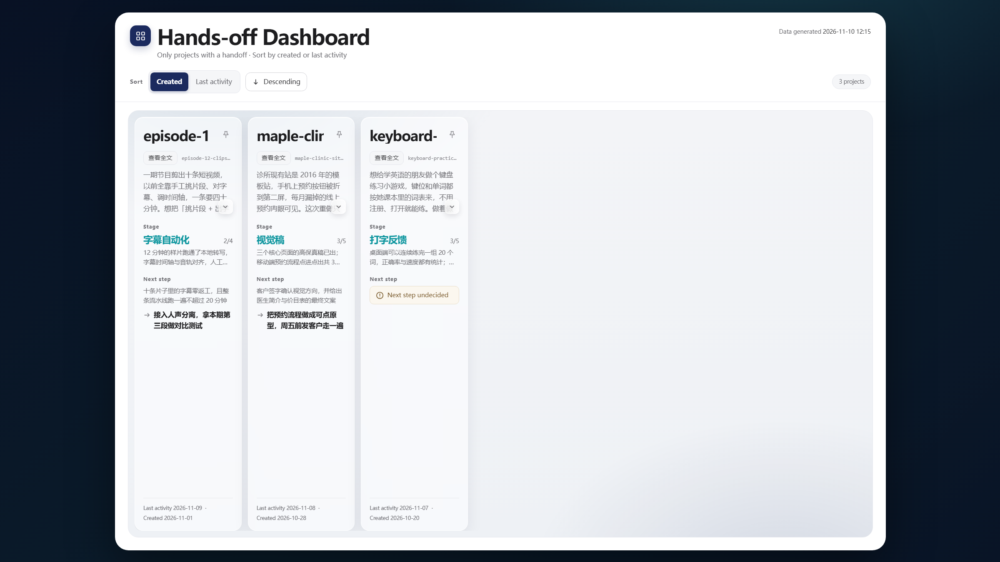

# Hands-off Dashboard

极简多进程项目管理数据版。把每个项目的 `HANDOFF.md` 变成桌面上的一张卡片：当前阶段、证据、卡点、下一步，快速查看项目进展。



## 为什么

有了AI之后，就开始尝试做各种东西。即便有了AI，我也会因为这些都是新东西而感到大脑过载。所以我在网上搜索，如何同时管理多进程任务，并且这些任务之间没什么关联。

上网搜索了一圈之后，这个问题我好像想明白了。所谓多进程任务之间切换带来的损失，主要是“上下文”遗忘，导致需要重新思考下一步该怎么办。这样每次切换到一个任务的时候就会产生固定思考成本。

这个问题的解法就是每次要切换的时候，趁自己还没有遗忘掉当前任务的上下文，先想清楚下一步。当之后再次回到这个任务的时候，直接照着之前的决策往下行动。

于是有了这块看板。

## 它做什么

- **每个项目一张卡**：`Stage`（当前阶段 + 阶段进度）、`Next step`、`Last activity`、`Created`，以及交接文档里的 Why 摘录。
- **为什么做**：卡片中间那段就是文档里的 `Why`，默认 6.4 行截断，点箭头展开——顺手提醒自己当初为什么开这个坑。
- **查看全文**：卡片标题下的「查看全文」，右侧抽屉渲染整份 markdown；开头的 `Key: value` 头部会渲染成字段面板，正文支持标题、列表、表格、代码、引用。
- **定位文件**：抽屉里一键在资源管理器里选中这份 md。
- **排序与置顶**：按创建时间或最近活动的升/降序；置顶存在 localStorage。
- **触屏**：手机上左右滑切项目、上下滑滚卡片内容。
- **容错**：缺字段显示占位文案，读不到文档时卡片上直接给出期望路径，不会报错也不会留空卡。

## 快速开始

需要 Node.js 18+。桌面组件额外需要 Windows（见下）。

**1. 在项目根目录写一份 `HANDOFF.md`**，开头是连续的 `Key: value`，空行之后是正文：

```
Audience: 谁在用这份文档
Why: 为什么要做这件事
Stages: 需求梳理 → 视觉稿 → 前端实现 → 上线
Current: 视觉稿
Evidence: 目前能拿出的证据
Gate: 什么条件算是这一步通过
Blocker: 当前卡点
Next-Determined: DETERMINED
Next: 下一个动作
Created: 2026-11-01
Last-Activity: 2026-11-09

# Handoff: 标题

正文随便写。
```

**2. 告诉看板去哪儿找项目**，编辑 `config.json`：

```json
{
  "roots": ["D:/Projects"],
  "port": 4177,
  "open": true
}
```

`roots` 里每个目录的**每个子文件夹都视为一个项目**，但只有根目录有 `HANDOFF.md` 的才会上板；没有的直接跳过，不留空卡。扫描会跳过隐藏目录、`node_modules` 之类，以及 `.git` 是文件而非目录的目录（git worktree），避免同一仓库出现两张卡。

**3. 起服务**

```bash
node server.js        # 或 npm start
```

浏览器会自动打开 `http://127.0.0.1:4177/`，端口被占用就顺延。Windows 上也可以直接双击 `start.bat`。

**4.（可选）桌面组件**：想省掉 `npm install`（Electron 约 350 MB），直接用「桌面安装包」一节的轻量版——4.6 MB 的安装包，只依赖系统自带的 WebView2。走 Electron 版则 `npm install` 一次，然后双击 `start-desktop.bat` 或跑 `npm run desktop`。

> 直接双击 `index.html` 打不开：浏览器不允许 `file://` 页面读本地文件，必须走本地服务。

## 桌面安装包（Windows）

想跳过上面四步，直接双击就能在桌面上看到组件。有两条同等功能的实现，按体积挑：

| 实现 | 安装包 | 装完占用 | 运行依赖 | 构建命令 |
| --- | --- | --- | --- | --- |
| **轻量版（推荐）** | **4.6 MB** | 约 9 MB | 系统自带的 WebView2 运行时 | `npm run dist:lite` |
| Electron 版 | 117 MB | 约 359 MB | 无（自带 Chromium） | `npm install && npm run dist` |

两者的**界面、接口、HANDOFF 解析、配置与状态文件完全相同**——轻量版把 Electron 那个 238 MB 的 Chromium 壳换成 Windows 自带的 WebView2，页面还是同一份 `index.html`。`desktop-state.json` 两份共用，随时可以换着跑。

### 轻量版（4.6 MB）

产物是 `lite/build/Hands-off-Dashboard-Lite-Setup-<版本>.exe`。双击后**没有安装向导、不需要管理员权限**：自动装到 `%LOCALAPPDATA%\Programs\Hands-off Dashboard`、装完立刻启动，组件直接出现在桌面上；同时生成桌面快捷方式、开始菜单入口、开机自启和卸载项。

- 构建：`npm run dist:lite`。需要 Go 工具链（默认找 `D:/2Enviroment/Go/bin/go.exe`，可用 `GO_BIN` 覆盖）和 NSIS（默认用 electron-builder 缓存里的那份，可用 `NSIS_MAKENSIS` 覆盖）。
- WebView2 运行时：Win11 与多数 Win10 自带。安装时若检测不到，会用随包的微软官方引导程序静默补齐（约 100 MB，需要联网）——这也是安装包比纯 exe 大 1.9 MB 的原因。
- 窗口透明、桌面贴底、右键面板、拖动、全局热键（`Ctrl+Alt+H` 隐藏/显示、`Ctrl+Alt+Q` 退出）全部与 Electron 版一致。

### Electron 版（117 MB）

产物是 `dist/Hands-off-Dashboard-Setup-<版本>.exe`。安装行为与轻量版相同（一键、免 UAC、装完启动、快捷方式/自启/卸载项齐全），但不需要任何系统运行时，任何 Windows 10/11 都能直接跑。

> 打包配置在 `electron-builder.yml`：不打 asar（`koffi` 的 `.node` 原生模块需要真实路径）、复用本机 `node_modules/electron/dist` 不重复下载 Electron、NSIS 一键安装。首次构建需要的 NSIS 二进制走 `npmmirror.com` 镜像（`scripts/build-installer.js`），避开被拦的 GitHub releases。`dist/` 与 `lite/build/` 都不进 git。

首次启动会弹出一个目录选择框，让你挑项目所在的工作目录（可多选）。选完就按 `HANDOFF.md` 出卡片；直接取消则显示随包附带的三个示例项目。之后在组件右键菜单 →「工作目录」里随时增删。

## 交接文档格式

头部字段，缺哪个都不影响解析：

| 字段                          | 含义                                  | 缺失时                              |
| --------------------------- | ----------------------------------- | -------------------------------- |
| `Audience`                  | 这份文档写给谁                             | 不显示                              |
| `Why`                       | 为什么要做                               | 卡片显示占位文案                         |
| `Stages`                    | 阶段序列，用 `→` 分隔                       | 不显示进度                            |
| `Current`                   | 当前阶段，命中 `Stages` 里某一项时卡片右上角显示 `3/5` | 显示「未标注阶段」                        |
| `Evidence`                  | 目前能拿出的证据                            | 占位文案                             |
| `Gate`                      | 通过条件                                | 占位文案                             |
| `Blocker`                   | 当前卡点                                | 占位文案                             |
| `Next-Determined`           | `DETERMINED` / `UNDETERMINED`       | 按未定处理，`Next step` 显示 `undecided` |
| `Next`                      | 下一个动作                               | 占位文案                             |
| `Created` / `Last-Activity` | 日期，用于排序                             | 排序时按最旧处理                         |

头部以第一个空行为界，之后才是正文。

## 桌面组件（Windows）

无边框透明窗口，插在桌面窗口（Progman）之上、所有普通窗口之下：会被窗口盖住，回到桌面就露出来；不占任务栏、不抢焦点。

| 操作           | 效果                        |
| ------------ | ------------------------- |
| 拖动卡片或空白处     | 移动位置（位置与尺寸自动记住）           |
| 右键           | 外观面板：外壳 / 卡片两个不透明度滑块 + 退出 |
| `Ctrl+Alt+H` | 隐藏 / 显示                   |
| `Ctrl+Alt+Q` | 退出                        |

`安装快捷方式.bat` 会建两个快捷方式（桌面 + 启动文件夹），指向 `electron.exe` 并带图标；`取消开机自启.bat` 撤销后者。重复启动无害，单实例锁会让第二次直接退出。

<details>

<summary>实现上踩过的坑（改之前务必读）</summary>

1. **必须保持顶层窗口，否则透明失效。** Electron 没有桌面层 API，只能用 `SetWindowPos` 排 Z 序；而 Chromium 的 alpha 合成只对顶层窗口生效，一旦用 `SetParent` 挂进桌面，透明区域会被画成不透明深灰。
2. **锚点不能直接用 Progman。** `SetWindowPos(hwnd, progman, ...)` 在 Win8+ 会返回 TRUE 却不改 Z 序（跨 z-band 请求被静默丢弃）。正确锚点是「Z 序上紧挨 Progman 之上的那个窗口」（`GetWindow(progman, GW_HWNDPREV)`）。
3. **`Win+D` 不是最小化，而是把 Progman 提到前面。** 组件只是掉到它后面被壁纸盖住，所以只能事后纠正：50 ms 巡护一次，在位时用一次 `GetWindow` 比较直接返回。
4. **`focusable: false` 会让拖动、菜单、滑条同时失灵。** Windows 上它等价于 `WS_EX_NOACTIVATE`，Chromium 会直接丢掉 `pointerdown`，`preventDefault()` 也救不回来。代价是点击会激活窗口，所以在 `focus` 时立刻压回底层。
   |   |   |
   | - | - |
5. **拖动要用 `screenX/screenY` + `SetWindowPos(..., SWP_NOSIZE | SWP_NOZORDER)`。** 用 `clientX/clientY` 反映不了真实位移；用 `setBounds` 在 150% 缩放下每次累积几个 DIP 的取整误差，连拖几次窗口就悄悄变大。
6. **`ELECTRON_RUN_AS_NODE` 会让整个方案失灵。** 某些 IDE 终端会带这个变量，Electron 退化成纯 Node，`require('electron')` 拿不到 `app`。`start-desktop.bat` 里已清空它和 `NODE_OPTIONS`。

</details>

## 配置

```json
{
  "roots": ["D:/Projects"],
  "port": 4177,
  "open": true,
  "ignore": ["some-dir-to-skip"]
}
```

命令行与环境变量可以覆盖：`--root`、`--port`、`--no-open`；`DASHBOARD_ROOT`、`DASHBOARD_PORT`（优先于配置文件）。

桌面组件还有独立的「工作目录」设置：右键菜单 →「工作目录」可添加（原生多选目录框）/ 移除，改完即时生效，配置存在 `%APPDATA%/hands-off-dashboard/desktop-state.json`，优先级高于 `config.json`。

## 接口

| 路径                                      | 说明                    |
| --------------------------------------- | --------------------- |
| `GET /api/projects`                     | 页面唯一使用的接口：全部项目与解析后的字段 |
| `GET /api/handoff?id=xxx`               | 交接文档原文 markdown       |
| `GET /api/reveal?id=xxx&target=handoff` | 在资源管理器里定位文件           |

服务只监听 `127.0.0.1`，不对外网开放，不写文件。

## 目录

```
index.html         单文件界面（内联 CSS/JS，无外部依赖）
server.js          零依赖 HTTP 服务（命令行与桌面组件共用）
lib/handoff.js     交接文档解析 + 项目发现
desktop/main.js    桌面组件主进程：贴桌面层、拖动、层级守护
desktop/preload.js 透明化样式注入、右键面板、不透明度、拖动交互
lite/              轻量版宿主（Go + 系统 WebView2），与 Electron 版同契约
  main.go          入口：单实例、启动服务、建窗、装 WebView2
  window.go        Win32 分层透明窗口、贴底巡护、拖动、DPI、热键
  data.go          HANDOFF 解析（lib/handoff.js 的逐字段复刻）
  server.go        三个 HTTP 接口 + 把 preload.js 包成桥脚本注入
  ipc.go           /api/desktop/<channel>，对应 Electron 的 10 个 IPC 通道
  dialog.go        原生目录选择（可多选）
  state.go         desktop-state.json 读写（与 Electron 版同一文件）
  installer.nsi    一键安装包脚本
build-demo.js      把当前数据打包成静态快照
examples/          三个虚构项目的交接文档，用于生成演示截图
scripts/           快捷方式安装、图标生成、两种安装包构建
test/              node --test 单元测试（npm test）
```

## 演示与测试

```bash
npm test                    # 解析与发现的单元测试
npm run build:demo:example  # 用 examples/ 的虚构数据生成 demo/index.html
npm run build:demo          # 用当前 config.json 的真实数据生成快照
```

`demo/index.html` 是把 `/api/projects` 与 `/api/handoff` 的返回值内嵌进页面、再用 fetch 拦截顶替这两个接口的静态快照，没有任何外部依赖，可以直接丢给静态托管或双击打开。数据是生成那一刻的快照，「定位文件」按钮会被隐藏。

## 常见问题

**页面提示没连上本地服务**：双击 `index.html` 不行，必须 `start.bat` 或 `node server.js`。

**改了文档卡片没变**：切回浏览器窗口会重读（30 秒节流），按 `F5` 立即生效；服务本身不缓存。

**某个项目显示找不到交接文档**：确认根目录有 `HANDOFF.md`（全大写，不在 `docs/` 里），卡片提示会给出期望路径。

**深链**：`?doc=<项目 id>` 可以直接打开某个项目的全文。

## 已知限制

- 桌面组件是 Windows 专属：两版都依赖 Win32 窗口层级（Progman 贴底）；Electron 版用 `koffi` 调 Win32，轻量版用系统 WebView2 运行时。网页版跨平台。
- 轻量版需要 WebView2 运行时（Win11 与多数 Win10 自带），缺失时由安装器联网补齐；Electron 版无此前提，但体积大 25 倍。
- 只有一个路径约定：项目根目录的 `HANDOFF.md`。想用别的文件名，只能改 `lib/handoff.js` 里的 `HANDOFF_NAME`。
- 仓库暂未声明开源许可证。
